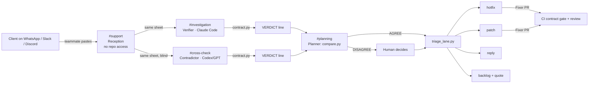

# Scope Firewall

**Is this client message free work (our bug) or paid work (a new feature)?**

One chat for the whole life of a client project, from the first brief to the next version:

| Phase | What happens | Tool | Human gate |
| --- | --- | --- | --- |
| Kickoff | `NEW PROJECT`, then `KICKOFF` with the client brief: the Planner drafts executable rules | `scope.py new`, `scope.py sign` | The client's rules are signed by a named person |
| Build | The plan lists every rule the app does not pass yet; the Fixer builds them by PR | `priorities.py plan` | PR review |
| Deliberation | Two providers judge each client message, blind, in separate rooms | `contract.py`, `compare.py` | A human settles any disagreement |
| Planning | Bugs are ranked, features quoted, releases planned | `triage_lane.py`, `priorities.py`, `versions.py` | Severity confirmed, quote sent by a human |
| Environments | Staging first; production refuses regressions; rollback one release at a time | `envs.py` | Named approval for production and for rollback |
| Evolution | A change request the client accepted amends the contract | `scope.py amend` | Signature; CI refuses any other change |

Agencies and freelancers lose the end of every MVP to "small fixes" that are really new features, and to arguments about whose fault a problem is. Scope Firewall settles both in the team's chat. A teammate pastes the client message into Switch. Two agents on **different providers**, sitting in **different rooms**, each run the signed contract against the live app. A script compares their verdicts, and a human decides only when they disagree. The result is one of four exits:

| Verdict | Exit |
| --- | --- |
| `defect`, security or critical | **hotfix** now: PR gated by CI, tech lead approves |
| `defect`, anything else | **patch**: batched, deployed in the quiet traffic window, users never blocked |
| `usage` | **reply**: a draft the human sends; no code |
| `out_of_scope` | **backlog**: a change request in [VERSIONS.md](VERSIONS.md) with a quote; the MVP stays frozen |



## Why Switch is the core, not a wrapper

- **Independence by room boundary.** The Contradictor is alone in `#cross-check`. It cannot read the Verifier's reasoning because it is not in that room, and the Verifier writes nothing to the repo until both verdicts are posted.
- **Two providers in one team.** Claude Code verifies and Codex (GPT) cross-checks, so the two checks don't share the same model's blind spots.
- **Security by room membership.** `#support` is the only room that receives untrusted text, and no agent in it has repo access. Addressing rules limit every other agent to its owner.
- **Humans in the loop where it matters.** The verdict and severity, every PR review, every deploy and every message to the client stay with a human.

## Nothing is left to model opinion

| Fact | Decided by | Tested by |
| --- | --- | --- |
| Does the app break the contract? | `tools/contract.py` runs real requests from [scope.json](scope.json) | `test_contract.py` (flags the 6 failing checks over HTTP and in-process, passes a correct implementation) |
| Do the two agents agree? | `tools/compare.py` on their `VERDICT` lines | `test_compare.py` |
| Which exit? | `tools/triage_lane.py` | `test_lane.py` |
| Which bug first? | `tools/priorities.py`: security, then severity, then clients affected; plans bugs and features | `test_priorities.py` |
| Can this reach production? | `tools/envs.py`: staging first; production refuses any regression, judged with today's contract, and needs a named approval | `test_envs.py` |
| Can we go back? | `tools/envs.py rollback`: one release at a time, with a named approval | `test_envs.py` |
| Is it really running? | `tools/envs.py status`: checks the process and the port, not just the ledger | replayed by hand |
| When to deploy a patch? | `tools/plan_window.py` on hourly traffic | `test_plan.py` |
| Does a change request stay out of the MVP? | `tools/versions.py` refuses v1.0, never opens SCOPE.md, quotes into the next undelivered version | `test_versions.py` |
| Is a change request really delivered? | `tools/versions.py` refuses while a rule signed for it fails | `test_versions.py` |
| Can the frozen contract be edited by hand? | CI `contract` job runs `scope.py verify-change`: rules only grow through an amendment for an accepted request | `test_scope.py` |
| Does the signed SCOPE.md match the executable contract? | `scope.json` is the source | `test_scope_sync.py` |
| Does every demo case end where we say? | all of the above, live | `test_cases.py` |
| Is a fix real? | CI `contract` job: no rule that passes on the base may fail on the PR, required on PRs | PR #2 (B11) passed it while B10 stayed open: a hotfix ships alone, nothing that passed may fail |

The two providers reached the same verdict on every case of the demo (B10, B11, B04); `tools/compare.py` is what flags a disagreement when there is one.

What only the models decide is which contract rule a message is about. That is exactly the judgment two providers cross-check, and a human settles any disagreement.

## Run it

```bash
docker compose up -d                                   # or: python3 demo-app/app.py &
python3 tools/contract.py check                        # in-process: F1 to F4 and F6 pass; F5 (display) is the open bug B10
python3 tools/contract.py check http://localhost:8080  # same checks over real HTTP (what CI runs)
python3 tools/contract.py verdict F4                   # defect, security: true (free orders)
python3 tools/compare.py "VERDICT B03 rule=F1 verdict=usage severity=low security=no" \
                         "VERDICT B03 rule=F2 verdict=defect severity=high security=no"   # DISAGREE
python3 tools/triage_lane.py defect high security      # hotfix
python3 tools/priorities.py plan 14                    # ranked open bugs + deliverables (versions)
python3 tools/envs.py status                           # which commit runs where, UP or DOWN right now
python3 tools/scope.py status                          # contract version, rules, amendments
python3 tools/plan_window.py data/traffic.csv minor 14 # patch window: 03:30
for t in tests/test_*.py; do python3 "$t" || break; done
```

## Start a new client project

1. In `#planning`, type `@bug-planner NEW PROJECT` (runs `scope.py new --replace-signed`: blank contract, empty ledgers; the demo's stay in git history). Replace `demo-app/app.py` with your app: it must keep the `H` request handler, because `tools/contract.py` drives it in-process, and `tools/envs.py` starts that file.
2. `@bug-planner KICKOFF <client brief>`: the Planner drafts the rules in `drafts/scope-v1.0.json` and posts a summary.
3. Once the client agrees, `@bug-planner I sign, <your name>`: the contract is frozen, and the plan lists every rule to build.
4. Ask the Fixer in `#investigation` for `BUILD v1.0`. Everything after that is the loop described above.

## Set it up in Switch

1. Install Switch Console and Docker. Log in to Claude Code (`claude auth login`) and Codex (`codex login`).
2. Connect Discord or Mattermost in Console.
3. Import `switch/bug-team.template.yaml` (Templates > Import). It creates 5 agents and 4 rooms. In the form, pick your clone of this repo as `project`, and check that `provider` and `contradictor_provider` are different.
4. On GitHub, make the `tests` and `contract` checks required for `main`, along with 1 review (Settings > Branches). A repository owner can still bypass them unless "Do not allow bypassing" is on.
5. In `#support`, type `@bug-reception B10: <paste the client message>` (you pick the id) and forward the sheet to `#investigation` and `#cross-check`.

## Demo cases

| # | Pasted message | Path |
| --- | --- | --- |
| B10 | "The checkout page shows the total without any currency." | F5 defect, low → patch v1.0.2 at 03:30 |
| B11 | "A customer entered quantity -3 and the checkout showed a negative total." | F6 defect, high, security → ranked before B10 → hotfix v1.0.1 → Fixer's PR #2 → CI (no regression) → staging → production with a named approval |
| B04 | "We need a PDF export of our orders for accounting." | none → out_of_scope → CR-001 in v1.1 with a quote; SCOPE.md untouched |

`bugs/cases.json` lists these and more (a client blaming themself, a prompt injection, a free-order exploit), each checked against the live app by `tests/test_cases.py`.

## Limits (stated, not hidden)

- Which rule a message maps to is decided by an LLM: that is why two providers check it and a human settles any disagreement.
- Verified in Switch: the template imports with two different providers and a project directory chosen in the form, and the agents post in Discord. Deleting rooms and recreating them under the same names left agents unable to post ("Not connected to a room"); recreating the agents from the template fixed it.
- The demo app is deliberately small: six rules, eleven checks. The contract format (`scope.json`) is not tied to it, but in-process checks and `envs.py` expect a Python app with an `H` handler at the path in `scope.json`.
- `envs.py` runs both environments as local processes on one machine, on ports 8080 and 8081.
- Moving a sheet or a VERDICT line between rooms is done by a human, on purpose: it is what keeps the rooms separate.
- The Planner writes the ledgers and the contract in the working tree and does not commit them: a human commits them, on a branch once `main` is protected.
- `scope.py new` is trusted in CI through its `replaced` date, so a pull request that sets that date is caught by the human review, not by CI.
- Demo video: [demo/scope-firewall-demo.mp4](demo/scope-firewall-demo.mp4), a screen recording of the team chat on Discord, run on Switch with Claude Code and Codex.

Spec: [SPEC.md](SPEC.md). Agents: [agents/README.md](agents/README.md).
