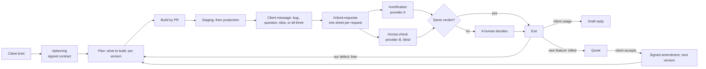

# Scope Firewall

**A client project, run from one team chat: what was promised, what is free, what is billed, and what ships when.**

On a client project, reporting a bug was hard, and bug reports came mixed with improvements that were never in the initial version. Nobody could say which was which, so the team reworked the same things, lost days, and could not plan a delivery.

Scope Firewall fixes this at the root: the project starts with a signed contract that a machine can run. Every later message is judged against it, split into free work and billed work, and placed in a release. Agents do the work on Switch, and people make every decision.

| Phase | In the chat | Decided by | Human gate |
| --- | --- | --- | --- |
| **1. Kickoff** | Paste the brief; the Planner drafts executable rules | `scope.py sign` | A named person signs |
| **2. Plan and build** | The plan lists every rule to build; the Fixer builds by PR | `priorities.py plan` | PR review |
| **3. Client requests** | Paste any message; Reception splits it, one sheet per request | Each request goes on alone | A teammate says `GO` on each sheet |
| **4. Verification** | Two providers judge each request, blind, in separate rooms | `contract.py`, `compare.py` | A human settles a disagreement |
| **5. Deliverables** | Fixes ranked, features quoted, releases planned, client update drafted | `triage_lane.py`, `priorities.py`, `versions.py` | Severity confirmed; a human sends everything the client sees |
| **6. Delivery** | Staging, then production; rollback if needed | `envs.py` | Named approval for production and rollback |
| **7. Evolution** | An accepted quote amends the contract for the next version | `scope.py amend` | Signature; CI refuses any other change |



One message, two fates: "The total has no currency, and please add a PDF export" becomes **R12a**, a free patch, and **R12b**, a quote for v1.1. Neither one delays the other.

| Verdict | Exit |
| --- | --- |
| `defect`, security or critical | **hotfix** now: PR gated by CI, tech lead approves |
| `defect`, anything else | **patch**: batched, deployed in the quiet traffic window |
| `usage` | **reply**: a draft the human sends; no code |
| `out_of_scope` | **backlog**: change request and quote; the contract stays frozen |

## How Switch is used

Switch is the team's workplace, not a wrapper. The scripts answer questions; only Switch brings people and agents together under these rules.

| Switch feature | What it does here | Without it |
| --- | --- | --- |
| Rooms and membership | The Verifier and the Contradictor never share a room, so neither can read the other | The second opinion is no longer blind |
| Agent hand-off | Reception sends each sheet into both rooms; the Planner reads both verdicts and tells the Fixer what to do | A person copies text between rooms all day |
| Two providers in one team | Claude Code verifies, Codex (GPT) cross-checks | Both checks share the same blind spots |
| Addressing rules | Anyone can reach Reception, which has no repo access; the other agents answer only their owner | A client's text could steer an agent that holds the code |
| Template | `switch/scope-firewall.template.yaml` creates the 5 agents, 4 rooms and their links in one import | Hours of setup for each new client |
| Bridge to the team chat | The team works in Mattermost or Discord, where it already is | People leave their chat to run tools |
| Humans in the room | Signatures, reviews and approvals happen in the same conversation as the work | Decisions end up outside the record |

## Nothing is left to model opinion

| Question | Decided by | Tested by |
| --- | --- | --- |
| Does the app break the contract? | `contract.py` sends real requests from [scope.json](scope.json) | `test_contract.py` |
| Do the two agents agree? | `compare.py` on their `VERDICT` lines | `test_compare.py` |
| Which exit, which order? | `triage_lane.py`, then `priorities.py`: security, severity, clients affected | `test_lane.py`, `test_priorities.py` |
| Does every sample request end where we say? | all of the above, live, including mixed messages | `test_cases.py` |
| Can this reach production? | `envs.py`: staging first, no regression under today's contract, named approval | `test_envs.py` |
| Can we go back? | `envs.py rollback`: one release at a time, named approval | `test_envs.py` |
| When to deploy a patch? | `plan_window.py` on hourly traffic | `test_plan.py` |
| Is a feature kept out of the contract? | `versions.py` quotes it into the next undelivered version | `test_versions.py` |
| Is a change request really delivered? | `versions.py` refuses while a rule signed for it fails | `test_versions.py` |
| Can the frozen contract be edited by hand? | CI runs `scope.py verify-change`: it only grows through an accepted amendment | `test_scope.py` |
| Is a fix real? | CI `contract` job: no rule that passes on the base may fail on the PR | PR #2 shipped a security fix while a display bug stayed open |

What only the models decide is which rule a message is about. That is exactly the judgment two providers cross-check, and a human settles any disagreement.

## Try it in two minutes (no Switch needed)

Needs Python 3 only. These are the commands the agents run.

```bash
python3 tools/scope.py status                          # the signed contract
python3 tools/contract.py check                        # F5 fails on purpose: it is the open request R10
python3 tools/priorities.py plan 14                    # ranked work and deliverables, per version
python3 tools/priorities.py client 14                  # draft update: free, billed, waiting for the client
python3 tools/compare.py "VERDICT R03 rule=F1 verdict=usage severity=low security=no" \
                         "VERDICT R03 rule=F2 verdict=defect severity=high security=no"   # DISAGREE
for t in tests/test_*.py; do python3 "$t" || break; done
```

## Run it in Switch

Needs Switch Console, Docker, and Claude Code and Codex logged in (`claude auth login`, `codex login`). Mattermost comes with Switch, so no workspace is needed.

1. Clone this repository.
2. In Console, open Templates > Import and pick `switch/scope-firewall.template.yaml`. It creates 5 agents and 4 rooms. Choose your clone as `project`, and check that `provider` and `contradictor_provider` are different.
3. On GitHub, make the `tests` and `contract` checks required on `main`, with 1 review.
4. Start the sample app: `docker compose up -d`, or `python3 demo-app/app.py &`.

Then run a whole project from the chat:

| Where | Type | What happens |
| --- | --- | --- |
| `#planning` | `@scope-planner NEW PROJECT` | Blank contract, empty ledgers; the sample stays in git history |
| `#planning` | `@scope-planner KICKOFF <client brief>` | Rules drafted and summarised |
| `#planning` | `@scope-planner I sign, <your name>` | Contract frozen, plan lists what to build |
| `#verification` | `@scope-fixer BUILD v1.0` | Branch, build, PR |
| `#client-requests` | `@scope-reception R12: <client message>` | One sheet per request |
| `#client-requests` | `@scope-reception GO R12a` | Reception hands the sheet to both verification rooms; two VERDICT lines come back |
| `#planning` | `@scope-planner COMPARE R12a` | The Planner reads both rooms, checks agreement, picks the exit, updates the plan |
| `#planning` | `@scope-planner client update` | A draft for you to send |

For your own project, replace `demo-app/app.py`: keep the `H` request handler, because `contract.py` drives it in-process and `envs.py` starts that file.

## Sample requests

| Id | Client message | Path |
| --- | --- | --- |
| R10 | "The checkout page shows the total without any currency." | F5 defect, low → patch v1.0.2 at 03:30 |
| R11 | "A customer entered quantity -3 and the checkout showed a negative total." | F6 defect, security → ranked first → hotfix → PR #2 → staging → production with a named approval |
| R04 | "We need a PDF export of our orders for accounting." | No rule → out of scope → CR-001 in v1.1 with a quote; the contract is untouched |
| R12 | "The total has no currency, and please add a PDF export." | Split: R12a free patch, R12b quote |

[cases/cases.json](cases/cases.json) has more: a client blaming themself, a prompt injection, a free-order exploit. `tests/test_cases.py` checks each one against a frozen copy of the shipped app.

## Limits

- Which rule a message maps to is decided by an LLM: that is why two providers check it and a human settles any disagreement.
- Not yet run end to end in Switch: the `GO` and `COMPARE` hand-offs (built on Switch's `send_targeted_message` and `read_context`) and the approval prompt for production.
- The sample app is small: six rules, eleven checks. Checks over HTTP work with any app; in-process checks and `envs.py` expect a Python app with an `H` handler.
- `envs.py` runs both environments as local processes on one machine, on ports 8080 and 8081.
- The Planner pushes ledgers straight to `main`, so its account needs to bypass branch protection. CI still checks every contract change.
- `scope.py new` is trusted in CI through its `replaced` date: a pull request that sets that date is caught by the human review, not by CI.
- Times, traffic numbers and client messages are sample data.

Rules and security: [SPEC.md](SPEC.md). Agents: [agents/README.md](agents/README.md). Ledgers: [SCOPE.md](SCOPE.md), [VERSIONS.md](VERSIONS.md), [QUEUE.md](QUEUE.md), [ENVIRONMENTS.md](ENVIRONMENTS.md), [DECISIONS.md](DECISIONS.md).
